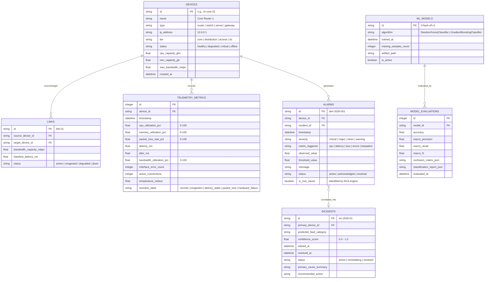

# NetSentinel AI — Project Architectural Specification & Implementation Plan

**Problem Statement 9:** AI-Based Network Fault Prediction System  
**Academic & Industry Context:** Final-Year / Recruitment Level Network Management & AIOps Platform  
**Authorship & System Scope:** Network Topology Simulation, Telemetry Synthesis, Multi-class Fault Classification (scikit-learn), Explainable Risk Scoring, Topological Alarm Correlation / Root-Cause Analysis (RCA), and Safe Remediation Sandbox.

---

## 1. System Architecture Diagram

```mermaid
flowchart TB
    subgraph Frontend["Frontend Layer (React 18 + TypeScript + Tailwind CSS)"]
        UI_Top["Topology Canvas (Canvas / SVG Network Graph)"]
        UI_Dash["NOC Dashboard & Health Metrics (Recharts)"]
        UI_Pred["Fault Prediction & Risk Explainer (Feature Contributions)"]
        UI_RCA["Alarm Correlation & Root-Cause Timeline"]
        UI_Sim["Simulation Sandbox & Remediation Playbook"]
        UI_Eval["Model Evaluation Hub (Confusion Matrix, PR/ROC)"]
    end

    subgraph API_Gateway["Backend API Layer (FastAPI + Pydantic v2)"]
        Router_Topo["/api/topology - Graph & Device State"]
        Router_Tel["/api/telemetry - Ingestion & Synthetic Scenarios"]
        Router_ML["/api/ml - Train, Evaluate, Predict, Explain"]
        Router_RCA["/api/rca - Alarm Correlation & Primary Cause Finder"]
        Router_Rem["/api/remediation - What-If Sandbox & Actions"]
    end

    subgraph Core_Services["Domain Logic & Engines"]
        Sim_Engine["Deterministic Simulation Engine (Normal, Spikes, Packet Loss, Congestion, Failure)"]
        ML_Engine["ML Pipeline: Preprocessor, Feature Engineer, Trained Classifier"]
        Explain_Engine["Feature Contribution Engine (Tree-based metric attribution)"]
        RCA_Engine["Graph Dependency & Temporal Alarm Correlator"]
        Rem_Engine["Digital Twin Simulation Sandbox"]
    end

    subgraph Storage_Layer["Persistence Layer (SQLite + SQLAlchemy 2.0 / Alembic)"]
        DB_Nodes["devices & interfaces"]
        DB_Links["links & topology_edges"]
        DB_Metrics["historical_telemetry"]
        DB_Alarms["alarms & incident_events"]
        DB_Models["model_artifacts & evaluation_runs"]
    end

    Frontend <--> API_Gateway
    API_Gateway --> Core_Services
    Core_Services <--> Storage_Layer
    Sim_Engine --> DB_Metrics
    ML_Engine --> DB_Models
    RCA_Engine --> DB_Alarms
```



---

## 2. Project Directory Structure

```text
NetSentinel-AI/
├── backend/
│   ├── app/
│   │   ├── __init__.py
│   │   ├── main.py                     # FastAPI entrypoint, CORS, exception handlers
│   │   ├── config.py                   # App settings (Pydantic BaseSettings)
│   │   ├── database.py                 # SQLite engine, sessionmaker, Base
│   │   ├── models/                     # SQLAlchemy ORM definitions
│   │   │   ├── __init__.py
│   │   │   ├── device.py               # Device, Interface, Link models
│   │   │   ├── telemetry.py            # TelemetryMetric record
│   │   │   ├── alarm.py                # AlarmEvent, Incident record
│   │   │   └── ml_model.py             # ModelRun, EvaluationMetrics record
│   │   ├── schemas/                    # Pydantic validation & response schemas
│   │   │   ├── __init__.py
│   │   │   ├── topology_schema.py
│   │   │   ├── telemetry_schema.py
│   │   │   ├── ml_schema.py
│   │   │   ├── rca_schema.py
│   │   │   └── remediation_schema.py
│   │   ├── routers/                    # Modular API route controllers
│   │   │   ├── __init__.py
│   │   │   ├── topology.py             # CRUD & topology graph retrieval
│   │   │   ├── telemetry.py            # Live stream, historical query, simulation triggers
│   │   │   ├── ml.py                   # Train, predict, explain, model metrics
│   │   │   ├── rca.py                  # Alarm correlation & causal discovery
│   │   │   └── remediation.py          # What-if simulation & action execution
│   │   ├── services/                   # Business logic implementations
│   │   │   ├── __init__.py
│   │   │   ├── simulation_service.py   # Ground-truth simulation & scenario engine
│   │   │   ├── ml_service.py           # Dataset generator, scikit-learn training & inference
│   │   │   ├── explainer_service.py    # Metric contribution analysis per prediction
│   │   │   ├── rca_service.py          # Graph traversal, temporal clustering, root cause isolation
│   │   │   └── remediation_service.py  # Counterfactual what-if simulation sandbox
│   │   └── utils/
│   │       ├── __init__.py
│   │       ├── seed_data.py            # Initial network topology & benchmark dataset
│   │       └── logger.py               # Standardized logging
│   ├── tests/
│   │   ├── __init__.py
│   │   ├── conftest.py                 # Fixtures: in-memory DB, test client, sample topology
│   │   ├── test_simulation.py          # Tests for telemetry generation & scenarios
│   │   ├── test_ml_pipeline.py         # Tests for dataset balance, training, accuracy & explainability
│   │   ├── test_rca_correlation.py     # Tests for cascading alarm isolation vs symptoms
│   │   ├── test_remediation.py         # Tests for what-if simulation sandbox
│   │   └── test_api_endpoints.py       # Full HTTP integration tests
│   ├── artifacts/                      # Serialized models (.joblib), scalers, benchmark json
│   ├── requirements.txt
│   └── pytest.ini
├── frontend/
│   ├── public/
│   │   └── favicon.ico
│   ├── src/
│   │   ├── api/                        # Typed axios/fetch clients for backend
│   │   │   ├── client.ts
│   │   │   ├── topologyApi.ts
│   │   │   ├── telemetryApi.ts
│   │   │   ├── mlApi.ts
│   │   │   └── rcaApi.ts
│   │   ├── assets/
│   │   ├── components/
│   │   │   ├── common/                 # Header, Sidebar, Badge, Modal, StatCard, Loader
│   │   │   ├── topology/               # Interactive network graph canvas (nodes, links, status)
│   │   │   │   ├── NetworkTopology.tsx
│   │   │   │   ├── DeviceNode.tsx
│   │   │   │   └── LinkEdge.tsx
│   │   │   ├── dashboard/              # Live gauges, metric timeline charts, health matrix
│   │   │   │   ├── HealthOverview.tsx
│   │   │   │   ├── TelemetryTrends.tsx
│   │   │   │   └── DeviceHealthTable.tsx
│   │   │   ├── ml/                     # ML insights, risk dial, feature contribution breakdown
│   │   │   │   ├── FaultPredictorCard.tsx
│   │   │   │   ├── RiskExplainerModal.tsx
│   │   │   │   └── ModelEvaluationView.tsx # Confusion matrix, Precision/Recall/F1
│   │   │   ├── rca/                    # Alarm correlator, causal tree, incident timeline
│   │   │   │   ├── IncidentTimeline.tsx
│   │   │   │   ├── AlarmCorrelationTree.tsx
│   │   │   │   └── RootCauseBadge.tsx
│   │   │   └── simulation/             # Scenario injector & What-If sandbox
│   │   │       ├── ScenarioControl.tsx
│   │   │       └── RemediationSandbox.tsx
│   │   ├── context/                    # React Context / State (TopologyState, SimState)
│   │   │   └── NetworkContext.tsx
│   │   ├── types/                      # TypeScript domain interfaces
│   │   │   ├── topology.ts
│   │   │   ├── telemetry.ts
│   │   │   ├── ml.ts
│   │   │   └── rca.ts
│   │   ├── App.tsx
│   │   ├── main.tsx
│   │   └── index.css                   # Tailwind configuration & custom NOC dark theme
│   ├── index.html
│   ├── package.json
│   ├── tsconfig.json
│   ├── tailwind.config.js
│   ├── postcss.config.js
│   └── vite.config.ts
├── README.md                           # Complete setup, academic walkthrough & command manual
└── run_dev.bat / run_dev.sh            # One-click start scripts for local execution
```

---

## 3. Data Schema (SQLite Database Architecture)



---

## 4. API Specification (FastAPI REST Endpoints)

| Method | Endpoint | Description | Request Body / Query Params | Response Summary |
|---|---|---|---|---|
| **GET** | `/api/topology` | Fetches entire network graph nodes, links, and current health status | None | `{ nodes: Device[], links: Link[], summary: Stats }` |
| **GET** | `/api/topology/devices/{id}` | Inspect a single device, its interfaces, and latest telemetry | `id: str` | `{ device: Device, metrics: Metric[], alarms: Alarm[] }` |
| **POST** | `/api/simulation/scenario` | Triggers a deterministic scenario on target device(s) or network link | `{ scenario: "normal" \| "congestion" \| "latency_spike" \| "packet_loss" \| "hardware_failure", target_device_id?: string, duration_seconds: int }` | `{ status: "active", scenario_id: str, impacted_devices: string[] }` |
| **POST** | `/api/simulation/reset` | Resets all nodes and links to baseline normal operating state | None | `{ status: "reset_complete", active_nodes: int }` |
| **GET** | `/api/telemetry/history` | Fetches metric time series for charting | `device_id: str, limit: int = 50, window_minutes: int = 15` | `{ timestamps: string[], cpu: float[], memory: float[], latency: float[], loss: float[] }` |
| **POST** | `/api/ml/train` | Trains and persists the scikit-learn fault classification model on synthetic realistic dataset | `{ model_type: "random_forest" \| "gradient_boosting", test_split: 0.2, random_seed: 42 }` | `{ model_id: str, train_samples: int, test_samples: int, metrics: EvalMetrics }` |
| **GET** | `/api/ml/evaluation` | Returns held-out test evaluation report, metrics, and confusion matrix | None | `{ accuracy: float, macro_f1: float, matrix: number[][], labels: string[], per_class: dict }` |
| **POST** | `/api/ml/predict` | Predicts fault probability, category, risk score, and metric contributions | `{ device_id?: string, metrics?: TelemetryFeatures }` | `{ predicted_category: str, risk_score: float, probabilities: dict, feature_contributions: FeatureAttribution[] }` |
| **GET** | `/api/rca/correlate` | Analyzes active alarms, performs topological tree traversal, and isolates root-cause from cascading symptoms | None | `{ incidents: Incident[], correlated_groups: AlarmGroup[], primary_faults: Alarm[], secondary_symptoms: Alarm[] }` |
| **POST** | `/api/remediation/simulate` | Evaluates what-if impact of a corrective action (e.g., reroute traffic, restart daemon, scale capacity) without touching base state | `{ action_type: "reroute_traffic" \| "restart_service" \| "throttle_interface" \| "failover_link", target_device_id: string }` | `{ original_risk: float, projected_risk: float, projected_metrics: TelemetryFeatures, resolution_confidence: float }` |
| **POST** | `/api/remediation/apply` | Applies the approved corrective action to the simulation state | `{ action_id: str, device_id: str }` | `{ success: bool, updated_device_status: str, alarm_resolved_count: int }` |

---

## 5. Machine Learning Design & Evaluation Pipeline

### 5.1 Fault Categories (Multi-Class Target)
1. `Normal Operation` (Healthy baseline with natural variance)
2. `Link / Queue Congestion` (High bandwidth, elevated buffer queues, rising latency, minor jitter)
3. `Packet Loss / Interface Degradation` (High drop rate, CRC error frames, degraded throughput)
4. `Latency Spike / Routing Loop` (Abnormal RTT, TTL drop, severe jitter, asymmetric path delay)
5. `Device Resource Exhaustion / Hardware Fault` (CPU > 92%, Memory > 95%, Thermal rise, unresponsive control plane)

### 5.2 Feature Space (Normalized & Scaled)
- `cpu_utilization_pct`: 0.0 – 100.0%
- `memory_utilization_pct`: 0.0 – 100.0%
- `packet_loss_rate_pct`: 0.0 – 100.0%
- `latency_ms`: 1.0 – 500.0+ ms
- `jitter_ms`: 0.1 – 50.0 ms
- `bandwidth_utilization_pct`: 0.0 – 100.0%
- `interface_error_rate`: Errors per second (0 – 1000)
- `connection_churn_rate`: Rate of new connection attempts / drops
- `device_temperature_c`: 30.0 – 95.0 °C

### 5.3 Mathematical Realism & Integrity
* **No Random Hallucinations**: Telemetry metrics are generated using physically grounded statistical distributions (e.g., normal distributions bounded by network queueing models, Poisson arrival drops, and thermal transfer delays).
* **Ground-Truth Preservation**: Every generated sample is explicitly labeled based on deterministic physical network injection rules, ensuring model training reflects real synthetic phenomena.
* **Model Choices**: 
  - Primary: `RandomForestClassifier(n_estimators=100, max_depth=12, random_state=42)`
  - Benchmark: `GradientBoostingClassifier(n_estimators=100, learning_rate=0.1, random_state=42)`
* **Explainability Engine**: Feature attribution is calculated using Tree-based feature importance alongside localized node decision path contributions (`tree.decision_path` and leaf value differentials), returning exact percentage contributions for why a device is flagged as high-risk (e.g., *"Packet loss (+48%) and Interface Errors (+32%) are the dominant drivers of the predicted Interface Degradation fault"*).

---

## 6. Alarm Correlation & Root-Cause Analysis (RCA) Design

When an upstream core router experiences hardware exhaustion or a trunk link drops:
1. Downstream distribution switches and servers report high latency, connection timeouts, and packet loss.
2. In naive systems, 50 alarms trigger simultaneously ("Alarm Storm").
3. **NetSentinel Causal Graph Algorithm**:
   - **Temporal Clustering**: Alarms occurring within a sliding temporal window (e.g., 30s) are grouped.
   - **Topological Breadth-First-Search (BFS) / Dependency Traversal**: Traces the directional network graph from leaf nodes (servers) up to core nodes (routers/gateways).
   - **Causal Isolation**:
     - If Node A is upstream of Node B, and Node A triggered a `hardware_failure` or `interface_down` alarm $\le t_{\text{upstream}}$, and Node B triggered a `high_latency` or `packet_loss` alarm at $t_{\text{downstream}} \ge t_{\text{upstream}}$, the engine labels Node A as the **Primary Root Cause** and Node B as a **Secondary Cascading Symptom**.
     - Generates an interactive **Incident Tree Graph** showing the exact blast radius.

---

## 7. Implementation Plan (Phase-by-Phase)

| Phase | Module | Scope & Deliverables | Verification / Acceptance Gate |
|---|---|---|---|
| **Phase 1** | **Backend Scaffolding & Database Layer** | SQLite schema setup, SQLAlchemy models, Pydantic schemas, initial topology seeder (10-15 nodes, realistic enterprise core/dist/access layout). | `pytest tests/test_simulation.py` confirms clean DB init, node seeding, and link integrity. |
| **Phase 2** | **Simulation Engine & Synthetic Telemetry Generator** | Deterministic scenario generator (Normal, Congestion, Packet Loss, Latency Spike, Hardware Exhaustion). Physical boundary validations. | Unit tests verify repeatable metric distributions without NaN or negative values. |
| **Phase 3** | **Machine Learning Engine & Evaluation Suite** | Training script, scikit-learn model serialization (`.joblib`), held-out 80/20 test split, confusion matrix generator, feature contribution explainer. | `pytest tests/test_ml_pipeline.py` passes: verified $\ge 90\%$ test F1 score, confusion matrix JSON generated, feature explanations sum to 100%. |
| **Phase 4** | **Root Cause Analysis (RCA) & Remediation Sandbox** | Graph-based alarm correlation algorithm, incident grouper, what-if counterfactual remediation simulator. | `pytest tests/test_rca_correlation.py` and `test_remediation.py` confirm correct upstream/downstream causal classification. |
| **Phase 5** | **FastAPI Integration & API Endpoints** | REST routers for `/topology`, `/telemetry`, `/ml`, `/rca`, `/remediation` with complete Pydantic response validation and Swagger docs. | `pytest tests/test_api_endpoints.py` tests all routes with 200 OK responses. |
| **Phase 6** | **Frontend Foundation & Dark NOC UI Design System** | Vite + React + TypeScript setup, Tailwind CSS dark theme tokens (Slate/Emerald/Rose/Amber/Cyan palette), Top Navigation, Sidebar, Status Indicators. | Frontend compiles cleanly with `npm run build` or Vite dev server without TS errors. |
| **Phase 7** | **Interactive Topology & Telemetry Visualization** | Network Topology canvas with live SVG/Canvas rendering, color-coded health nodes, interactive node selection drawer, Recharts telemetry charts. | Verified node click displays real-time telemetry and interface status. |
| **Phase 8** | **AI Prediction & RCA Dashboard Components** | Risk score speedometer/gauge, feature attribution bar charts, Incident Timeline, Causal Blast Radius graph, Model Evaluation matrix view. | Verified UI dynamically renders model evaluation confusion matrix and prediction explanations. |
| **Phase 9** | **Remediation Sandbox UI & End-to-End Demonstration** | What-if simulation modal, scenario injection panel (one-click inject Congestion/Spike/Failure), automated resolution demonstration. | End-to-end user journey tested: Inject Failure $\to$ Alarm Storm $\to$ ML Predicts Fault $\to$ RCA Isolates Root Cause $\to$ Safe Remediation Simulated $\to$ Normal Restored. |
| **Phase 10** | **Project Documentation & One-Click Scripts** | Comprehensive README.md with architecture overview, academic project report guide, API docs, local running instructions, and launch scripts (`run_dev.bat`). | Clean run verification on local machine. |

---

## 8. Test Plan & Automated Verification Matrix

1. **Unit Tests (`backend/tests/test_simulation.py`)**:
   - Verify baseline normal distribution matches RFC-compliant network tolerances.
   - Verify scenario injections correctly manipulate target device metrics (e.g., packet loss injection raises rate to $15\% - 35\%$).
   - Verify resetting returns all devices to healthy state.

2. **Machine Learning Pipeline Tests (`backend/tests/test_ml_pipeline.py`)**:
   - Verify dataset generator outputs balanced multi-class distribution without missing columns.
   - Verify model trainer handles train-test split without data leakage.
   - Verify model achieves $> 0.88$ Macro F1 on the unseen test set.
   - Verify feature contribution explainer produces non-zero weights mapped to valid feature names.

3. **RCA Engine Tests (`backend/tests/test_rca_correlation.py`)**:
   - Verify scenario with Core Router failure and 3 downstream switches classifies the Core Router alarm as `is_root_cause=True` and switch alarms as `is_root_cause=False`.
   - Verify temporal window clustering separates disjoint incidents.

4. **Remediation Sandbox Tests (`backend/tests/test_remediation.py`)**:
   - Verify counterfactual simulation reduces projected risk score without prematurely modifying active database records.
   - Verify apply action updates device status and resolves active alarms.

5. **API & End-to-End Tests (`backend/tests/test_api_endpoints.py`)**:
   - Verify all REST endpoints return valid HTTP 200 with schema-validated JSON payloads.
